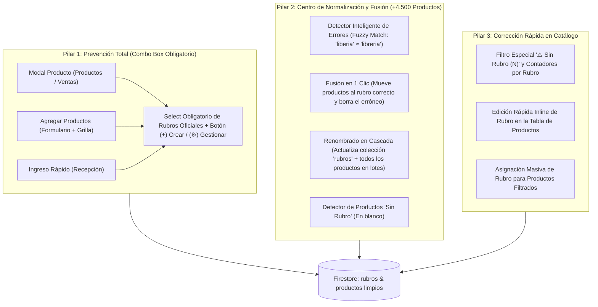

# Plan de Implementación: Estandarización de Rubros y Centro de Normalización de Catálogo (+4.500 Productos)

## Objetivo
Eliminar por completo los errores de escritura (`liberia`, `lireria`, mayúsculas/minúsculas, rubros vacíos) estandarizando el campo **Rubro** en todo **POS 2025** mediante un **Combo Box (`<select>`) obligatorio con gestión integrada (`+` Crear / `⚙️` Editar y Fusionar)**, acompañado de un **Centro Inteligente de Normalización de Rubros** diseñado específicamente para auditar, corregir, renombrar y fusionar rubros masivamente sobre los **+4.500 productos** existentes sin esfuerzo manual.

---

## Arquitectura de la Solución (3 Pilares UX/UI & Datos)

---

## Decisiones de Diseño Destacadas

> [!IMPORTANT]
> **1. Combo Box Obligatorio con Creación y Gestión In-Place (`+` y `⚙️`)**
> * En lugar de un campo de texto libre con `<datalist>`, todos los formularios de producto usarán un `<select class="form-select" required>` alimentado en tiempo real por los rubros oficiales normalizados.
> * Al lado del selector habrá un botón **`+`** para dar de alta un nuevo rubro oficial al instante (con validación anti-duplicados y normalización automática) y un botón **`⚙️`** para abrir el gestor de rubros.
> * **Campo 100% Obligatorio**: Ningún producto podrá crearse ni guardarse con el rubro en blanco.

> [!TIP]
> **2. Detector Automático de Errores Ortográficos (Similitud / Levenshtein) y Fusión en 1 Clic**
> * Con más de 4.500 productos, buscar errores a ojo es tedioso. El nuevo **Centro de Gestión y Normalización de Rubros** analizará en memoria los 4.500 productos al instante (sin lecturas extra a Firebase) y agrupará todos los rubros en uso.
> * Si detecta nombres muy parecidos (ej. `liberia` con 3 productos y `lireria` con 1 producto frente a `libreria` con 950 productos), mostrará una **Sugerencia Inteligente de Fusión**: con un solo clic en **"Unificar en Libreria"**, actualizará los productos afectados en lotes (`writeBatch` de Firestore con barra de progreso) y eliminará el rubro mal escrito.

> [!NOTE]
> **3. Edición Rápida "En Línea" (Inline) y Asignación Masiva para Productos en Blanco**
> * En el filtro de Rubro de **Gestión de Productos**, se agregará la opción **`⚠️ SIN RUBRO / EN BLANCO (N productos)`** además del contador de productos por cada rubro.
> * En la tabla de productos, hacer clic sobre el badge de Rubro de cualquier fila (o sobre el badge rojo `⚠️ Sin Rubro`) permitirá **cambiarle el rubro directamente desde la tabla con un mini-selector** sin necesidad de abrir todo el modal del producto.
> * También podrás filtrar varios productos (por ejemplo, buscar `"cuaderno"`) y usar la nueva acción masiva **"Asignar Rubro a Filtrados"** para ponerles `Libreria` a todos juntos.

---

## Cambios Implementados por Componente

1. **Modal Global de Producto y Utilidades** ([index.html](file:///d:/Curso/POS%202025/index.html) y [utils.js](file:///d:/Curso/POS%202025/utils.js)):
   - `#producto-rubro` convertido en `<select required>` con botones `+` y `⚙️`.
   - Funciones globales `levenshteinDistance`, `findSimilarRubro`, `getListaRubrosOficiales`, `populateRubroSelect` y `promptCrearNuevoRubro`.
2. **Sección Gestión de Productos y Centro de Normalización** ([productos.html](file:///d:/Curso/POS%202025/secciones/productos.html) y [productos.js](file:///d:/Curso/POS%202025/secciones/productos.js)):
   - Botón **"Gestionar Rubros"** (`#btnGestionarRubros`) con badge de alertas.
   - Modal `#modalGestionRubros` con KPIs, sugerencias inteligentes de unificación en 1 clic, renombrado en cascada, fusión y eliminación por lotes de 400 documentos.
   - Filtro `⚠️ Sin Rubro / En blanco (N)`, edición inline haciendo clic sobre el badge de rubro en la tabla y asignación masiva de rubro en `#collapseFiltros`.
3. **Carga de Productos e Ingreso Rápido** ([carga-productos.html](file:///d:/Curso/POS%202025/secciones/carga-productos.html), [carga-productos.js](file:///d:/Curso/POS%202025/secciones/carga-productos.js), [recepcion.html](file:///d:/Curso/POS%202025/secciones/recepcion.html), [recepcion.js](file:///d:/Curso/POS%202025/secciones/recepcion.js)):
   - Selector obligatorio de Rubro con botón `+` en formulario, grilla de preparación e ingreso rápido.
