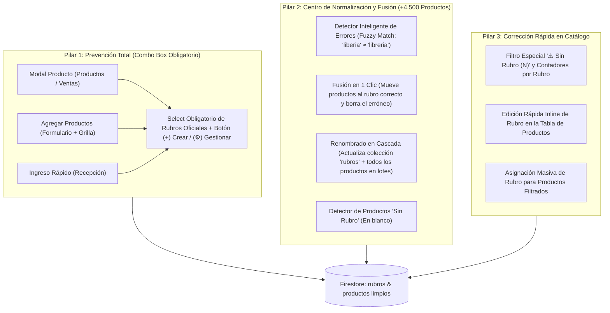

# Plan de Implementación: Estandarización de Rubros y Centro de Normalización de Catálogo (+4.500 Productos)

## Objetivo
Eliminar por completo los errores de escritura (`liberia`, `lireria`, mayúsculas/minúsculas, rubros vacíos) estandarizando el campo **Rubro** en todo **POS 2025** mediante un **Combo Box (`<select>`) obligatorio con gestión integrada (`+` Crear / `⚙️` Editar y Fusionar)**, acompañado de un **Centro Inteligente de Normalización de Rubros** diseñado específicamente para auditar, corregir, renombrar y fusionar rubros masivamente sobre los **+4.500 productos** existentes sin esfuerzo manual.

---

## Arquitectura de la Solución (3 Pilares UX/UI & Datos)

---

## Cambios en "Agregar Productos" (`carga-productos`) y Acceso Global al Gestor de Rubros

1. **Caché de Secciones HTML (`app.js`)**:
   - `loadSection(section)` ahora utiliza `cache: 'no-store'` con bust de versión para que el navegador nunca sirva HTML antiguo en caché al cambiar a **Agregar Productos**.
2. **Modal Global `#modalGestionRubros` en `index.html`**:
   - Se mueve `#modalGestionRubros` (con `#rubros-sugerencias-list` incluido) a `index.html` y se exporta `abrirModalGestionRubros()` desde `productos.js`, permitiendo abrir el Centro de Normalización de Rubros desde **Productos**, **Agregar Productos**, **Ingreso Rápido** o **Ventas**.
3. **Interfaz Completa de Rubros en `secciones/carga-productos.html` y `secciones/carga-productos.js`**:
   - Botón **"Gestionar Rubros"** en la cabecera de **Carga y Preparación de Productos**.
   - Selector obligatorio **`Rubro *`** acompañado de ambos botones: **`+`** (crear nuevo rubro) y **`⚙️`** (abrir el gestor para editar/renombrar/fusionar rubros).
   - Alerta visual `#prod-rubro-warning` cuando se escanea/edita un producto existente en la base de datos que no tenía rubro o tenía un rubro mal escrito.
   - Combo Box de Rubro en cada fila de la tabla **"Productos en Preparación"**.
